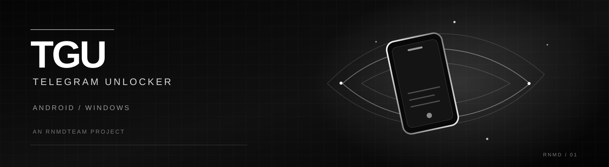
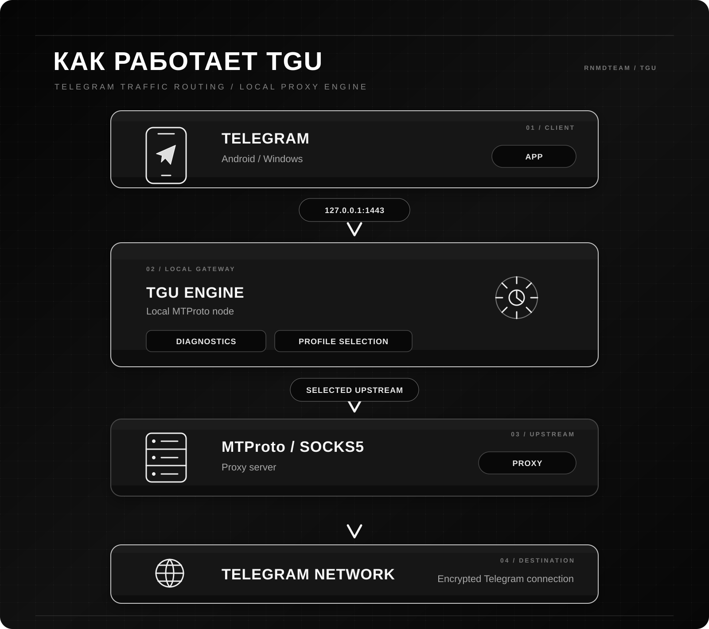

# Техническая документация TGU Public

> Исходный подробный README сохранён здесь. Главная страница проекта оформлена графикой.

---

<!-- TGU README -->

<p align="center">
  
</p>

<p align="center">
  <strong>Локальный прокси-движок и диагностика подключения Telegram</strong>
  <br>
  <sub>Один проект · Android и Windows · RNMDTEAM</sub>
</p>

<p align="center">
  <a href="https://github.com/sergeyrenamed-coder/TGU-Public/releases/tag/android-v0.9.4"></a>
  <a href="https://github.com/sergeyrenamed-coder/TGU-Public/releases/tag/windows-v0.3.0"></a>
  <a href="https://github.com/sergeyrenamed-coder/TGU-Public/actions/workflows/build-android.yml"></a>
  <a href="https://github.com/sergeyrenamed-coder/TGU-Public/actions/workflows/build-desktop.yml"></a>
</p>

<p align="center">
  <a href="https://github.com/sergeyrenamed-coder/TGU-Public/releases"><strong>ВСЕ СБОРКИ</strong></a>
  &nbsp; · &nbsp;
  <a href="https://rnmdstore.netlify.app/#/tgu"><strong>RNMDSTORE</strong></a>
  &nbsp; · &nbsp;
  <a href="https://t.me/RNMDSTOREbot"><strong>TELEGRAM-БОТ</strong></a>
</p>

---

## О проекте

**TGU (Telegram Unlocker)** — приложение RNMDTEAM для диагностики подключения Telegram и маршрутизации его соединений через выбранный прокси.

TGU поднимает локальный MTProto-узел, к которому подключается Telegram, а затем направляет соединение через выбранный upstream. В проекте есть диагностика, проверка прокси, профили и автоматическое переключение маршрутов.

> **Важно:** TGU не создаёт системный VPN и не перенаправляет трафик остальных приложений. Локальный прокси предназначен для Telegram. Наличие прокси в каталоге не гарантирует, что он будет доступен в конкретной сети.

## Скачать

<p align="center">
  <a href="https://github.com/sergeyrenamed-coder/TGU-Public/releases/download/android-v0.9.4/TGU-Android-v0.9.4-debug.apk"></a>
  &nbsp;
  <a href="https://github.com/sergeyrenamed-coder/TGU-Public/releases/download/windows-v0.3.0/TGU-Desktop-v0.3.0-portable.exe"></a>
</p>

| Платформа | Версия | Файл | Статус |
|---|---:|---|---|
| Android | 0.9.4 | [TGU-Android-v0.9.4-debug.apk](https://github.com/sergeyrenamed-coder/TGU-Public/releases/download/android-v0.9.4/TGU-Android-v0.9.4-debug.apk) | Предварительная сборка |
| Windows | 0.3.0 | [TGU-Desktop-v0.3.0-portable.exe](https://github.com/sergeyrenamed-coder/TGU-Public/releases/download/windows-v0.3.0/TGU-Desktop-v0.3.0-portable.exe) | Предварительная сборка |

**Перед установкой:**
- Android APK подписан debug-ключом и предназначен для тестирования. Если подпись установленной версии отличается, Android может потребовать удалить старую версию перед установкой новой.
- Windows EXE — portable-сборка без цифровой подписи издателя. Windows может показать стандартное предупреждение о неизвестном издателе.
- Это предварительные сборки, а не финальный стабильный выпуск.

Все версии и история изменений: **[GitHub Releases](https://github.com/sergeyrenamed-coder/TGU-Public/releases)**.

## Возможности

<table>
  <tr>
    <td width="50%" valign="top">
      <h3>Диагностика</h3>
      Проверка доступности Telegram DC, DNS, TCP, TLS/SNI и HTTP-ответов. Результаты зависят от текущей сети и точки проверки.
    </td>
    <td width="50%" valign="top">
      <h3>Прокси-профили</h3>
      Хранение и управление профилями классического MTProto и SOCKS5. Учётные данные не должны попадать в диагностические отчёты.
    </td>
  </tr>
  <tr>
    <td width="50%" valign="top">
      <h3>Автоматический выбор</h3>
      Проверка доступных кандидатов и выбор подходящего маршрута с повторной проверкой результатов на устройстве.
    </td>
    <td width="50%" valign="top">
      <h3>Failover</h3>
      Автоматическое переключение на другой маршрут при устойчивых ошибках текущего upstream.
    </td>
  </tr>
  <tr>
    <td width="50%" valign="top">
      <h3>Локальный MTProto</h3>
      Telegram подключается к локальному адресу TGU — <code>127.0.0.1:1443</code>. Сам TGU работает с выбранным внешним прокси.
    </td>
    <td width="50%" valign="top">
      <h3>RNMD ID · Android</h3>
      Вход в аккаунт RNMDTEAM через Telegram Native Login, просмотр устройств и состояния доступов.
    </td>
  </tr>
</table>

## Платформы

### Android

**Kotlin · Jetpack Compose · Android SDK**

- Локальный MTProto-сервис для Telegram.
- Upstream-профили MTProto и SOCKS5.
- Диагностика сети и Telegram DC.
- Каталог прокси и локальная проверка кандидатов.
- Автоматический выбор маршрута и failover.
- RNMD ID, список устройств и состояние TGU+.
- Шифрование локальных учётных данных с использованием Android Keystore.

Исходный код: **[android/](../android/)** · [Подробная документация](android/README.md).

### Windows

**Tauri 2 · Rust · React · TypeScript**

- Портативный Windows-клиент.
- Локальный MTProto-узел для Telegram.
- Upstream-профили MTProto и SOCKS5.
- Проверка маршрутов, автоматический выбор и failover.
- Хранение секрета MTProto в Windows Credential Manager.
- Русскоязычный интерфейс и работа из системного трея.

Исходный код: **[desktop/](../desktop/)** · [Подробная документация](desktop/README.md).

## Как это работает

<p align="center">
  
</p>

TGU обслуживает только подключение Telegram через собственный локальный узел. Это не системный VPN-туннель.

## Конфиденциальность и безопасность

- TGU не запрашивает доступ к перепискам Telegram, контактам или номеру телефона.
- Telegram Native Login в Android использует scopes `openid` и `profile` для входа в RNMD ID.
- Локальные прокси-учётные данные Android хранятся в зашифрованном виде с использованием Android Keystore.
- В Windows секрет MTProto хранится через Windows Credential Manager.
- В Android нет стороннего аналитического или usage-telemetry endpoint.
- Отправка анонимных результатов проверок в общественную сеть TGU Community Network отключена по умолчанию и требует явного согласия пользователя.

Не отправляйте в Issues, чаты поддержки и публичные отчёты пароли, приватные MTProto secrets, токены, файлы сессий или персональные данные.

## Сборка из исходников

### Android

Требуются Android Studio / Android SDK Platform 36, JDK 17 и Gradle 8.13.

```powershell
cd android
.\gradlew.bat :app:assembleDebug
```

Готовый APK:

```text
android/app/build/outputs/apk/debug/app-debug.apk
```

### Windows

Требуются Node.js 20+, Rust stable и Visual Studio Build Tools с C++ workload и зависимостями Tauri 2.

```powershell
cd desktop
npm install
npm run build
npm run tauri build
```

Для запуска в режиме разработки:

```powershell
npm run tauri dev
```

## Разработка и CI

GitHub Actions автоматически проверяет изменения:

| Workflow | Что проверяется |
|---|---|
| [Android CI](../.github/workflows/build-android.yml) | Сборка debug APK и unit-тесты |
| [Windows CI](../.github/workflows/build-desktop.yml) | TypeScript, Rust tests и portable EXE |
| [Release pipeline](../.github/workflows/release.yml) | Сборка и публикация Android/Windows prerelease |

Сборки создаются на GitHub-hosted runners. Для Android CI может использовать настроенную debug-подпись; при отсутствии соответствующих secrets применяется временный debug-ключ.

## Дорожная карта

- [x] Android — локальный MTProto-движок и диагностика
- [x] Windows — portable-клиент Tauri/Rust
- [x] Профили MTProto и SOCKS5
- [x] Автоматический выбор маршрута и failover
- [x] Публичные тестовые сборки Android и Windows
- [x] RNMD ID на Android
- [ ] Стабильная подпись Android APK
- [ ] Подпись Windows-приложения сертификатом издателя
- [ ] Расширенное тестирование на разных устройствах и сетях
- [ ] Подготовка стабильного релиза 1.0

## Ссылки

| Ресурс | Ссылка |
|---|---|
| Публичный исходный код | [TGU-Public](https://github.com/sergeyrenamed-coder/TGU-Public) |
| Все сборки | [GitHub Releases](https://github.com/sergeyrenamed-coder/TGU-Public/releases) |
| Магазин | [RNMDSTORE](https://rnmdstore.netlify.app/#/tgu) |
| Telegram-бот | [@RNMDSTOREbot](https://t.me/RNMDSTOREbot) |
| Каталог прокси | [TGU Proxy Directory](https://github.com/sergeyrenamed-coder/TGU-Proxy-Directory) |
| Сообщить об ошибке | [GitHub Issues](https://github.com/sergeyrenamed-coder/TGU-Public/issues) |

## Лицензия

Основная часть проекта распространяется по **Apache License 2.0**. Уведомления сторонних компонентов и применимые лицензии сохранены в соответствующих каталогах `third_party/licenses`.

---

<p align="center">
  <strong>RNMDTEAM</strong>
  <br>
  <sub>Built with focus. Made for Telegram.</sub>
</p>
